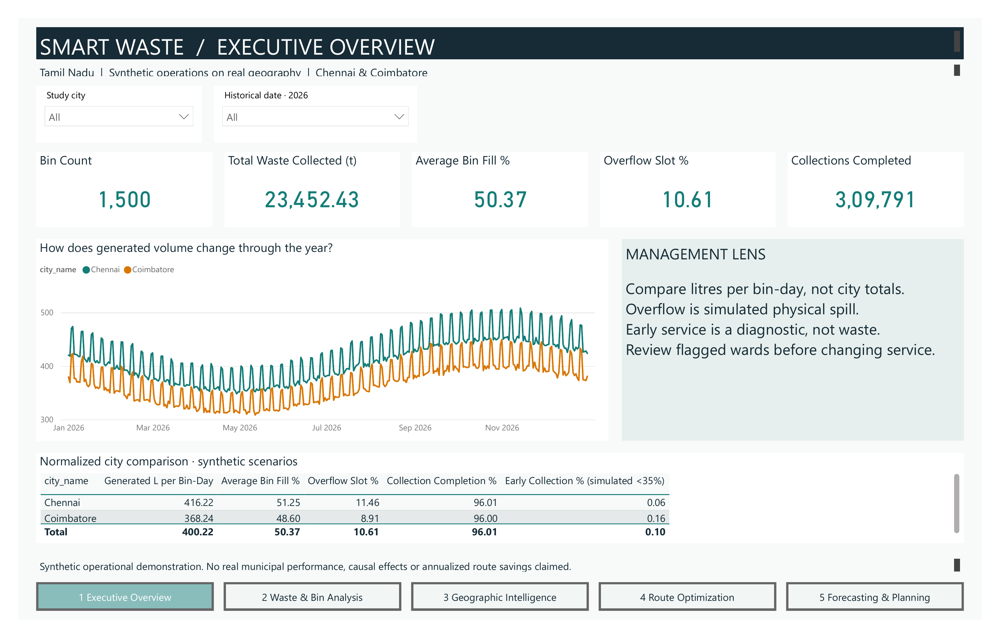
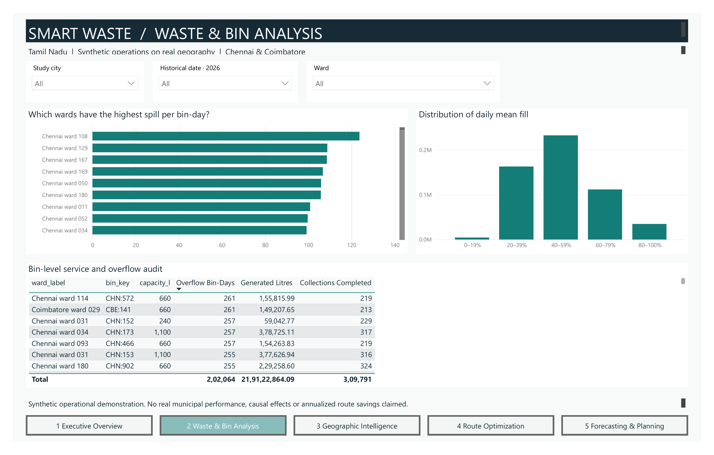
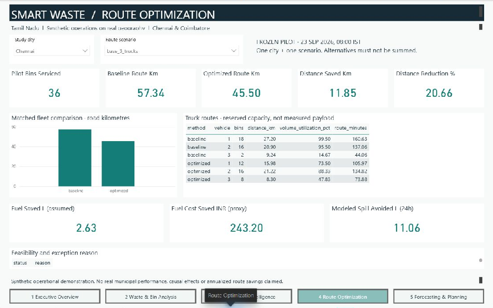
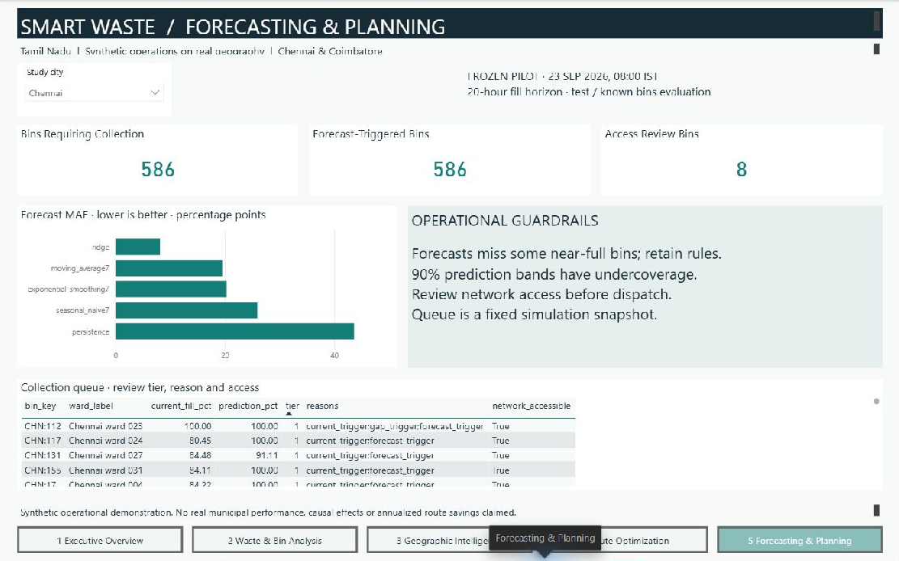
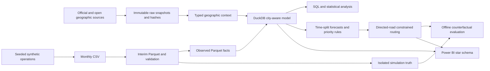

# Smart Waste Collection & Route Optimization

An auditable analytics portfolio for **Chennai and Coimbatore, Tamil Nadu**: real geographic context, **6,570,000 explicitly synthetic sensor records**, SQL, statistics, forecasting, constrained routing and a five-page Power BI dashboard.

## Problem and analytical questions

Fixed collection schedules can send vehicles to partly empty bins while other bins overflow. The analytical question is which bins need service, how that demand may change, and how a constrained fleet can serve selected bins efficiently.

A useful system must connect data quality, service risk and route feasibility. Minimizing distance alone can worsen later overflow; the project explicitly measures that tradeoff instead of assuming every shorter route is better.

## Key findings and decision value

| Matched synthetic pilot | Chennai | Coimbatore |
|---|---:|---:|
| Baseline km | 57.34 | 38.46 |
| Optimized km | 45.50 | 27.97 |
| Distance saved km | 11.85 | 10.48 |
| Reduction | 20.66% | 27.26% |
| Assumed fuel saved L | 2.63 | 2.33 |
| Historical-price fuel saving INR | 243.20 | 215.22 |

Fuel uses assumed 4.5 km/L; both cities use historical Chennai INR92.39/L as a common proxy. These are one-scenario estimates, not realized or annualized savings. Management should validate bin locations and truck access, run a measured shadow pilot, monitor missed overflows, and compare distance **and** service outcomes before changing operations.

- Demand and overflow patterns reflect explicit simulator mechanisms, useful for demonstrating QA and analysis rather than estimating city effects.
- Forecast accuracy improves over simple baselines, but limited near-full recall supports conservative service rules and operator review.
- Shorter routes do not universally reduce spill: negative counterfactual outcomes are retained.
- Raw city totals are not an efficiency ranking: bin counts, seeds, boundaries and Coimbatore's assumed 0.9 demand multiplier differ.

Known-bin test MAE: **8.17 pp CHN / 7.69 pp CBE**, versus seven-day moving-average **19.65 / 20.57 pp**. Near-full recall is only **56.18% / 57.97%**. Nominal 90% interval coverage is **88.45% / 88.22%**; uncertainty bands are empirical, not calibrated overflow probabilities. [Methodology](docs/phase4_methodology.md).

## Dashboard preview

Four report views connect collection demand, route planning and forecasting. Overview and bin analysis show all cities; routing and forecasting show Chennai. The map page is omitted because its visual is disabled in the current environment.

### Executive Overview



### Waste & Bin Analysis



### Route Optimization



### Forecasting & Planning



## Data sources and scope

| Canonical entity | Rows | Origin |
|---|---:|---|
| Sensor readings | 6,570,000 | Synthetic; CHN 4,380,000 / CBE 2,190,000 |
| Bins | 1,500 | Hypothetical placement at real OSM nodes |
| Ward geometries | 300 | 200 GCC; 100 community-distributed OpenCity |
| Bin-days | 547,500 | Derived synthetic |
| Collection attempts | 322,675 | Synthetic, including missed attempts |
| City-days | 730 | Derived synthetic |
| Route scenarios | 18 | Hypothetical constrained experiments |

Thirty catalog references include 26 preserved assets across 24 source IDs. Used context includes GCC wards, Census 2011, OSM roads/POIs, NASA POWER 2025 weather, OpenCity Coimbatore wards and official CCMC references. Historical fuel/emission references support scenario factors. Not every downloaded webpage or PDF is a model input. [Acquisition manifest](02_research/acquisition_manifest.csv) records exact URLs, dates, hashes and source-use caveats. Census population is not joined to incompatible current ward IDs; weather is a historical proxy. Raw sources remain local because redistribution rights vary.

## How the analysis was built

1. Acquire geographic context and preserve source hashes.
2. Generate seeded operations and convert monthly CSVs to partitioned Parquet.
3. Build city-aware DuckDB marts and reconcile SQL results.
4. Evaluate forecasts using chronological splits and compare constrained routes on matched stops.
5. Model the outputs in Power BI and validate measures against analytical results.

See [ETL design](docs/etl_phase2.md), [SQL analysis](05_sql/phase3_business_questions.sql), [forecasting and routing methods](docs/phase4_methodology.md), and [Power BI delivery](12_powerbi/DESKTOP_DELIVERY.md).

## Architecture


See [implemented model and units](docs/two_city_model.md), [ETL](docs/etl_phase2.md) and [source catalog](02_research/source_catalog.csv).

## Challenges and lessons

Forecast error alone does not establish safe collection decisions: near-full recall is limited, so service rules need conservative thresholds and operator review. Routing uses the same required stops and constraints for the baseline and optimizer; a shorter route can still worsen later overflow. Real road geometry provides context, but access restrictions and hypothetical bin locations require field verification.

The simulation separates observed sensor data from latent truth to prevent evaluation leakage. City totals also reflect different bin counts and assumptions, so they are not a municipal efficiency ranking.

## Tools and project structure

Actually executed: Python, Pandas, NumPy, PyArrow/Parquet, DuckDB/SQL, SciPy, scikit-learn, Shapely, PyProj, NetworkX, osmium, Folium, Matplotlib, OR-Tools, pytest, Excel QA workbook and Power BI Desktop/DAX. Git packages the sources. BigQuery is documentation only. GeoPandas/OSMnx are not claimed merely because early plans listed them.

Numbered folders separate business/research, local data, Excel, SQL/Python, statistics, geography, forecasting, optimization, cloud instructions, Power BI, testing and evidence. `cities/CBE` holds the isolated second-city workspace. `config` records assumptions. `docs` contains contracts, methodology, audit, recruiter/interview material and reproducibility notes. Large data, caches, installers and binaries remain ignored locally.

## Run the project

For a source-only first check, create a Python virtual environment and run:

```bash
python -m pip install -r requirements.txt
python -m pytest 13_testing/test_acquisition_safety.py -q
```

Large sensor tables, raw source snapshots, Parquet, DuckDB, PBIX and Excel binaries are excluded from this repository. Generate those outputs in the documented order before attempting full integration checks or refreshing the Power BI model. The current report builder overwrites definitions; use a disposable copy and preserve Desktop edits. The builder-preflight improvement remains in a separate PR and is not implied by this README.

Follow [the ordered reproduction guide](docs/REPRODUCTION.md). Existing-data audit avoids regeneration. A fresh clone requires acquiring licensed source snapshots and generating local data before integration tests; downloads may change or become unavailable. Do not run historical documentation finalizers over the final handover.

## Validation

Historical final-suite receipt: **43 tests passed**, including four new acquisition safety regressions. [Final audit evidence](14_outputs/reports/final_audit/audit_receipt.json) records exact row counts, origins, keys, raw hashes, partition pruning and PBIX integrity. Foundation: 13 checks. SQL: 14 + 24 city/filter executions. BI: 52 SQL/Python checks and 16 relationships. Historical Desktop: 52/52 DAX checks. The historical test count is recorded in [audit report](docs/FINAL_AUDIT.md). It is not a fresh full-suite run for this README update. Four source-only acquisition tests passed on 26 November 2026 using the existing local dependency environment. They can be run with `python -m pytest 13_testing/test_acquisition_safety.py -q`; integration tests require the excluded local data and outputs.

## Report availability

An actual local `12_powerbi/Smart_Waste_Chennai_Coimbatore.pbix` contains five pages: Executive Overview, Waste & Bin Analysis, Geographic Intelligence, Route Optimization, Forecasting & Planning. It uses 5 dimensions, 9 facts, 16 relationships and 35 DAX measures. Desktop rendering and 52 DAX reconciliations were verified in the delivery phase; archive integrity was rechecked during audit. No Power BI Service publication or scheduled refresh occurred.

The PBIX and data extracts are excluded from source Git history. [PBIP report/model definitions](12_powerbi/desktop_project), [DAX](12_powerbi/PHASE5_MEASURES.dax), [build instructions](12_powerbi/PHASE5_BUILD_GUIDE.md) and [delivery evidence](12_powerbi/DESKTOP_DELIVERY.md) remain reviewable. Refresh paths must be changed after relocation. Exhaustive filter combinations and narrow-window rendering were not verified.

## Limitations

This is a portfolio simulation, not a production municipal system. Real telemetry, GPS, depot/fleet constraints, current comparable demographics and contracted costs are unavailable. Statistics assess one synthetic realization. Forecast bands undercover. Road access is provisional; routing reserves full bin volume and allows one trip. Counterfactuals isolate 24 hours without other routine collections. Clean-machine regeneration and live cloud execution remain unverified. Notebooks have runnable script companions but no saved executed cell outputs.

## Further analysis

The [final report](FINAL_PROJECT_REPORT.md) covers statistical comparisons, geospatial assumptions, forecast evaluation and route trade-offs. [Source catalog](02_research/source_catalog.csv) and [acquisition manifest](02_research/acquisition_manifest.csv) retain provenance. BigQuery SQL is prepared but has not been executed.

## Author

[Aswin S](https://github.com/Ashwin76038)
